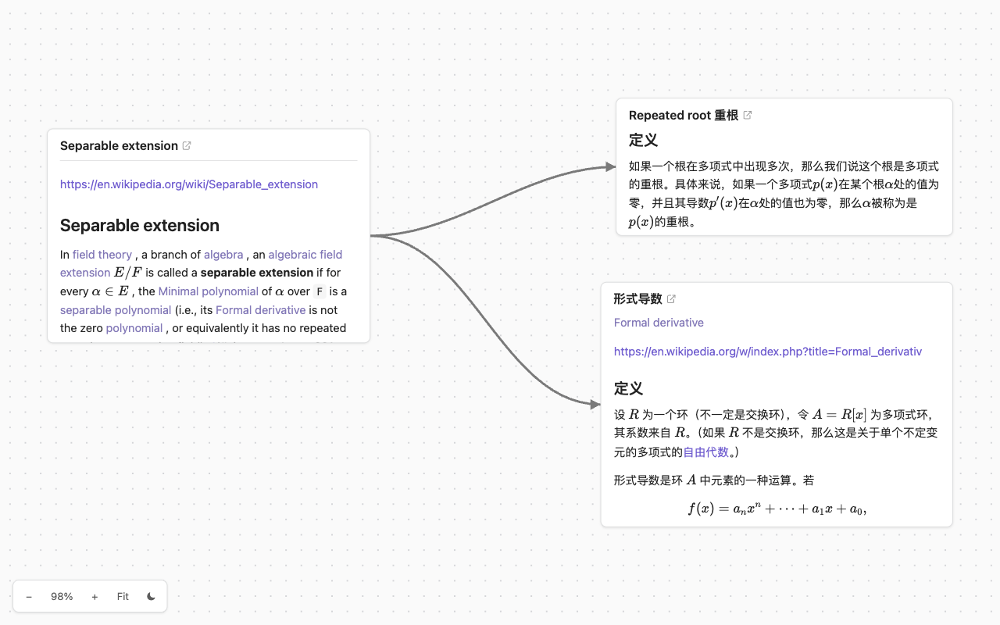

# obsidian-canvas-render

Render Obsidian `.canvas` files on the web, close to how Obsidian draws them — embedded notes, LaTeX, edges and all.

**[Live demo](https://drmingdrmer.github.io/obsidian-canvas-render/)**

The file format is [JSON Canvas](https://jsoncanvas.org), the open spec Obsidian publishes under the MIT license. Obsidian's own renderer cannot be reused — it is minified into `app.js` inside `obsidian.asar` and wired to Obsidian's internal Vault, Workspace and MarkdownRenderer objects — so this is a fresh implementation against the spec: no build step, nothing to install, three files a browser loads directly.

A board is read, not edited: it pans and zooms, cards move and resize, and nothing is written back to the `.canvas` file. Serving a canvas, deploying, the URL parameters and the controls are all in **[USAGE.md](USAGE.md)**. What a card's colour, an edge's sides and an edge's colour mean on a board is in **[CONVENTIONS.md](CONVENTIONS.md)**.

## Supported

Nodes: `text`, `file`, `link`, `group`.
Groups: `label`, and a `background` image in each `backgroundStyle`: `cover`, `ratio`, `repeat`.
Edges: `fromSide` / `toSide` (both optional), the `fromEnd` / `toEnd` arrow switches, `label`, `color`.
Colors: Obsidian's six presets (`"1"`–`"6"`) and custom hex values.

A text card whose first line is a paragraph with more text under it draws that line as a header strip and keeps it out of the body — a filled strip, where a file card's title row is transparent and carries links, so the two kinds of card stay apart. A first line that opens any other block — a heading, list, quote, code block, table or formula — belongs to what follows it and stays in the body, rendered as written. Obsidian heads text cards with nothing at all; this is a deliberate difference.

Every group is drawn behind every card. JSON Canvas stacks nodes in the order the file lists them, which would let a group listed after a card cover that card; this is a deliberate difference too.

Block-reference subpaths `#^blockid` render the whole document. A `[[wikilink]]` to a note that has a card on the board shows that card in a preview beside the link. Go to card in the preview, or Alt+click on the link, flies the view to the card. Any other wikilink opens the note on its own.

## License

The application code is licensed under [Apache-2.0](LICENSE). [marked](https://github.com/markedjs/marked) 12.0.2 ([MIT](lib/LICENSE-marked)), [KaTeX](https://katex.org) 0.16.11 ([MIT](lib/LICENSE-katex)) and [DOMPurify](https://github.com/cure53/DOMPurify) 3.4.16 ([Apache-2.0](lib/LICENSE-dompurify)) are vendored under `lib/` rather than loaded from a CDN, so the page works offline. The sample notes under `vault/pages/` are adapted from Wikipedia and stay under [CC BY-SA 4.0](https://creativecommons.org/licenses/by-sa/4.0/), each naming its source article at the bottom.
